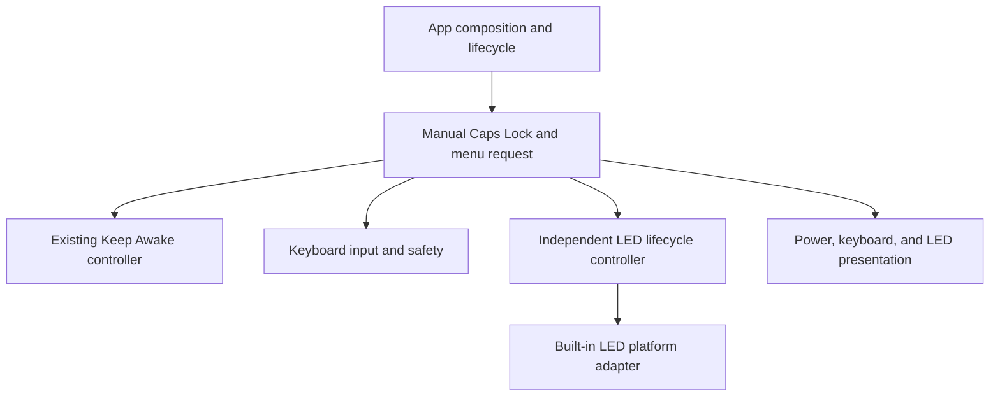

# Integrate persistent Caps Lock LED control

## Summary

Integrate the independently controlled LED and conservative recovery demonstrated
by the hardware probe into Cappuccino. Separate keyboard input, the manual
keep-awake request, and LED ownership so locking can disconnect keyboard control
without releasing either the power request or its indicator. Accept the brief
lock-transition flash; do not pursue notification callbacks or faster polling.

---

## Problem frame and evidence

The app currently controls the light by setting native Caps Lock, then filtering
the modifier out of events. Its keyboard cleanup also resets the light.
`Scripts/led-probe.swift` demonstrated a separate route on the user's built-in
keyboard on macOS 26.6.2: the private `HIDCapsLockLED` property lights the key
without enabling native Caps Lock.

The user confirmed recovery works while locked and accepted the brief flash.
Unified logs identified `com.apple.hiservices-xpcservice` resetting the override
to `Auto`; a subsequent LED-only `On` request restores the light. Successful
property writes alone are not physical proof, and other hardware is unverified.
The user also deliberately tested native Caps Lock on and off during the probe.

The probe is not a replacement for the app: it does not repurpose the Caps Lock
key, it expires, and its eight-attempt budget is a lifetime experiment limit.

| App state | Power request | Keyboard control | LED ownership |
|---|---|---|---|
| Startup / mode off | None | Connected when permitted | System-managed Auto |
| Mode on, unlocked | Retained | Connected when permitted | On with recovery |
| Mode on, locked / Secure Input | Retained | Suspended | On with recovery |
| Mode on, LED failure | Retained | Independently available or suspended | Degraded; warning and explicit retry |
| Off / quit | Released, with existing error handling | Reset/disconnect as appropriate | Recovery stopped before Auto cleanup |

When Auto is restored, the light resumes normal native Caps Lock indication; it
is not a forced-off override if the user has intentionally enabled native Caps
Lock while keyboard control is suspended.

---

## Requirements

- **R1. Persistent request:** keep-awake and its desired LED state survive
  lock/unlock, Secure Input, and keyboard reconnection. There is no probe-style
  60-second expiration or eight-lock lifetime limit.
- **R2. Independent output:** LED operations never enable native Caps Lock.
  Locked-screen LED recovery does not depend on an event tap.
- **R3. Consistent controls:** one eligible Caps Lock key action toggles the same
  manual request as the menu, regardless of the native modifier's current value
  or whether the menu was used previously.
- **R4. Safe suspension:** retain existing keyboard safety boundaries. Suspend
  filtering for lock/inactive sessions/Secure Input; do not capture or modify
  password input. Native Caps Lock remains the user's normal key while suspended.
- **R5. Conservative resources:** poll the LED at the proven 250 ms interval only
  while an active indicator is being maintained. No new LED polling while mode
  is off, and no repeated writes while all selected LEDs report On.
- **R6. Isolated failures:** LED discovery, acquisition, read, recovery, or cleanup
  failures do not cancel a successful power request. Present accurate power,
  keyboard, and indicator status and allow explicit recovery.
- **R7. Ordered cleanup:** stop monitoring before requesting Auto on off/quit.
  Late work must not reassert On after cleanup. Preserve existing power-cleanup
  semantics and never report a failed power acquisition as awake.
- **R8. Safe compatibility:** retain the current deployment target. Feature-detect
  the macOS 26+ built-in LED route; unsupported configurations retain existing
  awake controls with an indicator warning, not a native-Caps-Lock LED fallback.
- **R9. Scope preservation:** startup remains off. Lid closure and explicit sleep
  remain controlled by macOS. Preserve typing/filtering behavior and document its
  existing limitations instead of claiming a system-wide Caps Lock replacement.

---

## Scope boundaries

- Built-in keyboards on the experimentally verified route; no external-keyboard
  support expansion or new privileged helper, driver, or privacy permission.
- No notification-based recovery, transition bursts, zero-flash guarantee, or
  unmeasured energy-efficiency claims.
- No persisted awake state across process restarts, new triggers, agent/MCP/CLI
  product interfaces, timers, or settings UI.
- Keep the request-aggregation and power-assertion implementation unchanged.
  The LED represents the existing manual Caps Lock/menu request. Defining a
  machine-wide indicator for future additional triggers is separate work.
- Keep the diagnostic probe usable as a standalone comparison/recovery tool.
  Do not turn its script or Python test harness into app runtime dependencies.

### Deferred to follow-up work

- Notification support and flash reduction.
- Support beyond the validated OS/keyboard configuration.
- A stricter low-level Caps Lock replacement. Separating LED output does not
  by itself remove the current event filter's global-modifier limitations.

---

## Context and design

Relevant sources:

- `Sources/Cappuccino/Features/KeepAwake/Model/KeepAwakeController.swift`:
  idempotent request ownership and failure/cleanup semantics.
- `Sources/Cappuccino/Features/Triggers/CapsLock/Model/CapsLockTrigger.swift`:
  manual request ownership, keyboard suspension, and UI state publication.
- `Sources/Cappuccino/Features/Triggers/CapsLock/Model/KeyboardControl.swift` and
  `Sources/Cappuccino/Features/Triggers/CapsLock/Platform/MacCapsLockKeyboard.swift`:
  the current coupling between native modifier state, key actions, and the LED.
- `Sources/Cappuccino/App/AppDelegate.swift`: composition, lock/session/sleep
  handling, and keyboard reconnection.
- `Sources/Cappuccino/App/UI/StatusBarController.swift`: current status/retry UI.
- `Scripts/led-probe.swift`, `Scripts/test-led-probe.py`, and
  `Scripts/led-probe.md`: the tested hardware mechanism and its explicit limits.

No existing `docs/solutions/`, strategy, requirements document, or plan was
found. This plan uses the conversation's accepted behavior and probe notes as
its origin. Existing source and experimental evidence are sufficient for this
plan; callback research is deliberately not a prerequisite.

### Ownership

This illustrates the intended approach and is directional guidance for review,
not implementation specification.

- The trigger still owns one request, and remains the source of manual intent.
- The keyboard adapter owns input filtering and native Caps Lock cleanup, not
  forced LED output. Pausing it must not destroy the independent LED controller.
- The LED lifecycle controller owns desired output, polling, recovery limits,
  failure status, and cleanup. The platform adapter owns passive HID discovery,
  feature detection, property reads/writes, and service handles.
- The app constructs the adapters. Keep platform imports out of model code;
  use the existing single module and main-run-loop serialization convention.

### Key technical decisions

| Decision | Rationale |
|---|---|
| Key callbacks express a toggle action, not assignment from the native modifier bit | Independent LED output and menu changes mean native Caps Lock is no longer a source of awake intent. |
| Retain the existing keyboard filter and safety boundaries | The LED-only probe never solved physical-key interception or all typing behavior; replacing that subsystem is not required here. |
| LED failure is a warning, not a power rollback | A working sleep-prevention request must not depend on indicator availability. |
| Poll only while maintaining On, at 250 ms | Uses the hardware-validated behavior without high-frequency optimization or added off-state polling. |
| Limit recovery writes over time, not over the app session | Ordinary repeated locks must not permanently exhaust a probe budget. |
| Off/quit releases the override to Auto | Returns ownership to macOS rather than leaving a forced Off state. |
| Unsupported LED route never falls back to enabling native Caps Lock | Prevents reintroducing the unsafe coupling this integration is intended to remove. |

**Recovery policy:** start with a maximum of eight recovery writes in a rolling
ten-second window, excluding the initial On request and cleanup. Healthy On
readbacks cause no writes. Normal, spaced lock cycles can recover indefinitely.
If another write would exceed the rate budget, or state is unreadable or a write
is rejected, stop LED monitoring, attempt Auto restoration, and expose an LED
warning. The power request stays active. An explicit retry starts a fresh
indicator attempt; do not silently spin on a failed adapter.

The rate window is a conservative implementation decision, not a hardware
guarantee. Do not copy the probe's lifetime limit into the app. No global retry
framework or exponential-backoff subsystem is needed for this iteration.

**Native Caps Lock:** remove the keyboard API's LED-setting responsibility.
Retain explicit native-off cleanup for keyboard activation/suspension/stop and
an eligible explicit mode-off transition. Keep its event bookkeeping aligned
so that our reset cannot look like another user toggle. Do not repeatedly clear
native Caps Lock on the lock screen: once suspended, normal native key behavior
belongs to the user.

The active input-filter prototype can still encounter native Caps Lock internally
because the physical key changes it. Do not claim that LED separation alone fixes
that existing limitation or makes Secure Input detection instantaneous.

---

## Implementation units

### U1. Add an independent built-in LED platform adapter

**Goal:** move the proven LED-only capability into a testable app adapter.

**Requirements:** R2, R6, R8.

**Dependencies:** none.

**Files:**
- Create: `Sources/Cappuccino/Features/Triggers/CapsLock/Model/CapsLockLED.swift`.
- Create: `Sources/Cappuccino/Features/Triggers/CapsLock/Platform/MacCapsLockLED.swift`.
- Test: `Tests/CappuccinoTests/Features/Triggers/CapsLock/MacCapsLockLEDTests.swift`.

**Approach:** expose only the LED capabilities needed by the lifecycle controller.
Use dynamically resolved passive-client creation, positive built-in keyboard
matching, reported LED-state reads, and On/Auto requests. Constructors must not
write hardware. Attempt cleanup on every service after a partially accepted write;
retain usable handles when cleanup fails so a later retry can address it.
Keep unsupported capability distinguishable from a working adapter.

**Patterns to follow:** the probe's private-symbol handling and service matching;
the existing power adapter's explicit, retryable cleanup.

**Execution note:** test-first with injected service access; automatic tests must
not write the user's physical LED or request privacy grants.

**Test scenarios:**
- Happy path: a matching built-in keyboard can be read and receives On/Auto;
  an external keyboard is never selected.
- Edge case: no matching services, absent property, unavailable private symbol,
  or pre-26 OS becomes an explicit unsupported/unavailable result.
- Error path: one of several writes fails; cleanup is attempted for every
  selected service, and cleanup rejection is not silently reported as success.
- Integration: adapter construction and destruction without activation makes no
  LED writes, including duplicate-instance initialization.

**Verification:** app code has an independently injectable LED output with no
native modifier-state write, privileged setup, or script runtime dependency.

### U2. Add the LED lifecycle and conservative recovery policy

**Goal:** maintain an indicator independently of keyboard availability.

**Requirements:** R1, R5, R6, R7.

**Dependencies:** U1.

**Files:**
- Create: `Sources/Cappuccino/Features/Triggers/CapsLock/Model/CapsLockLEDController.swift`.
- Test: `Tests/CappuccinoTests/Features/Triggers/CapsLock/CapsLockLEDControllerTests.swift`.

**Approach:** own desired state, the scheduled check, rate accounting, and the
indicator failure separately from power/keyboard state. Use a small injectable
clock/scheduling seam for deterministic tests, not a general scheduler framework.
On starts the override and checks; reported Off prompts rate-limited recovery.
Off cancels/invalidate work before Auto restoration. Explicit retry can repair
failed cleanup before reacquiring output. Startup repair of a stranded override
is an explicit activation action, not a constructor side effect.

**Patterns to follow:** the probe's read-before-write recovery and cleanup order;
the keyboard adapter's generation guards against late callbacks.

**Execution note:** implement policy and lifecycle behavior test-first without
real timers, sleep calls, or hardware writes in policy tests.

**Test scenarios:**
- Happy path: enabling writes On and starts one monitor; healthy samples cause
  no more writes; a simulated competing reset is recovered.
- Edge case: repeated enable/disable/retry calls are idempotent. Mode off has no
  periodic LED reads, and old callbacks cannot write after off or re-enable.
- Persistence: more than eight spaced resets recover across a long session;
  there is neither a 60-second expiry nor a lifetime recovery budget.
- Error path: eight writes in the rate window followed by another required
  write degrades the indicator and restores Auto; unreadable state, rejected
  acquisition/recovery, and failed restoration surface their respective issues.
- Integration: explicit retry after failure restores the requested indicator;
  stop/owner destruction cancels monitoring before cleanup, including when
  cleanup itself fails.

**Verification:** simulated resets recover without keyboard events; no recovery
can occur after cleanup; failure does not require access to the power controller.

### U3. Wire independent input, power, indicator, and presentation

**Goal:** connect the new controller without changing power-request ownership or
losing keyboard/menu consistency.

**Requirements:** R1 through R9.

**Dependencies:** U1, U2.

**Files:**
- Modify: `Sources/Cappuccino/Features/Triggers/CapsLock/Model/KeyboardControl.swift`.
- Modify: `Sources/Cappuccino/Features/Triggers/CapsLock/Model/CapsLockTrigger.swift`.
- Modify: `Sources/Cappuccino/Features/Triggers/CapsLock/Platform/MacCapsLockKeyboard.swift`.
- Modify: `Sources/Cappuccino/App/AppDelegate.swift`.
- Modify: `Sources/Cappuccino/App/UI/StatusBarController.swift`.
- Test: `Tests/CappuccinoTests/Features/Triggers/CapsLock/CapsLockTriggerTests.swift`.
- Test: `Tests/CappuccinoTests/Features/Triggers/CapsLock/MacKeyboardEventTests.swift`.
- Test: `Tests/CappuccinoTests/App/AppDelegateTests.swift`.
- Test: `Tests/CappuccinoTests/Features/KeepAwake/MacSleepPreventionTests.swift`.
- Create/test as needed: `Tests/CappuccinoTests/App/StatusBarControllerTests.swift`.

**Approach:**
- Replace native-value assignment callbacks with eligible physical-key toggle
  actions. Keep duplicate suppression, reset bookkeeping, generation checks,
  Shift/shortcut preservation, and the no-Unicode-rewriting rule.
- Separate native-off cleanup from LED output. A menu action followed by a key
  action must toggle once, even if native Caps Lock and manual mode differ.
- Publish successful manual power intent independently of LED success. Replace
  the old indicator-failure-rolls-back-power expectation with failure isolation.
- Keyboard suspend/reconnect must leave the existing LED owner and power request
  intact. Lock/inactive/Secure Input still disables keyboard filtering, and
  reconnect must not interpret a native reset as a user request.
- Keep keyboard and LED issues independently representable; do not relabel an
  LED failure as a keyboard disconnection. Awake presentation remains truthful.
  Extend the existing retry action to retry whichever connection has a problem,
  including LED-only failure while the keyboard is healthy.
- Construct and activate the LED controller through app composition only after
  the single-instance guard. Never let an unactivated duplicate instance restore
  Auto over the first instance's active indicator.
- On off/quit, attempt power release, keyboard cleanup, and LED restoration even
  if another cleanup fails. Preserve current power retry/abandonment semantics.

**Patterns to follow:** existing trigger state publication and independent-request
tests; app session guards; current weak callback and main-run-loop conventions.

**Execution note:** characterize physical-key/native-reset assumptions before
changing their behavior; add failing model/integration regressions for menu/key
consistency and keyboard-independent LED lifetime.

**Test scenarios:**
- Happy path: key/menu changes the same request and desired LED once; menu then
  key works in both states even when native modifier state differs.
- Edge case: duplicate/late/native-reset events do not toggle intent. Keyboard
  reconnection does not release/reacquire power or reset desired LED.
- Lock flow: the app suspends the keyboard while fake LED ownership and real
  IOKit power assertions remain active; unlock restores only keyboard control.
- Secure Input flow: keyboard disconnection preserves LED ownership; menu off
  still releases the request and restores Auto while the keyboard is unavailable.
- Failure: unsupported/failing LED output leaves a successful awake request on,
  provides an LED-specific warning/retry, and never falls back to native Caps On.
- Failure: power acquisition fails, so no successful awake state or desired On
  is published. Power-release errors retain existing retry ownership semantics.
- Presentation: LED-only, keyboard-only, and combined failures remain
  distinguishable; a healthy keyboard does not hide an LED retry.
- Integration: quit while locked and destruction after suspension stop the LED
  monitor, attempt Auto, and release only this trigger's power request.
- Compatibility: unsupported LED capability does not prevent existing eligible
  keyboard/menu awake controls or alter the package deployment target.

**Verification:** existing ownership and real-power assertion checks remain valid,
and the packaged app's behavior matches the state table rather than the probe's
short-lived lifecycle.

### U4. Document and validate the integrated hardware workflow

**Goal:** establish that the complete app, not only the probe, behaves correctly.

**Requirements:** R1 through R9.

**Dependencies:** U3.

**Files:**
- Modify: `readme.md`.
- Modify: `Scripts/led-probe.md`.
- Preserve: `Scripts/led-probe.swift` and `Scripts/test-led-probe.py`.

**Approach:** document the independent indicator, accepted flash, resource policy,
unsupported capability, warning/retry behavior, and recovery after a crash.
Explain that the app uses a rate window rather than the experiment's lifetime
limit. Keep the original experimental tool available for isolated diagnosis.

**Test scenarios:**
- Run the full Swift suite, the existing probe's software checks, and the
  packaged-app build/signing workflow during execution.
- Hands-on: launch the app, enable by key and by menu, type lowercase/Shift
  uppercase and shortcuts, and repeat menu/key sequences in both states.
- Hands-on: repeat lock/unlock, including leaving the screen locked long enough
  to observe recovery before unlocking; confirm power assertions remain.
- Hands-on: keep mode active beyond the probe duration. Enter/leave Secure Input,
  explicitly sleep/wake, and switch off/quit while keyboard control is paused.
- Hands-on: exercise intentional native Caps Lock on/off while locked, then
  unlock/reconnect; ensure normal password behavior and no double toggle.
- Resource check: no LED monitor while off, no LED writes for healthy On
  readbacks, and no high-frequency transition timer.
- Recovery check: normal exit returns LED control to macOS. A failed restoration
  is visible. Forced termination may require restart or the standalone Auto
  restoration tool; do not promise SIGKILL-safe cleanup.

**Verification:** software evidence and a user-performed integrated-app acceptance
test both pass. Do not infer hardware safety from fake adapters or probe success.

---

## System-wide impact and risks

- Power-request semantics, assertion types, startup-off state, deployment target,
  and explicit-sleep/lid limits remain unchanged.
- The shared keyboard protocol and its test fakes change; update every conformer
  together with the trigger callback semantics.
- The one manual request drives the indicator. No aggregate-power observer or
  future-trigger framework is introduced.
- LED state is process-managed and hardware-global: other utilities can compete.
  Preserve the single-instance guard and document the single-owner assumption.
- All work remains serialized on the main run loop. Stop/generation ordering is
  essential at off, quit, suspension, retry, and delayed callback boundaries.

| Risk | Treatment |
|---|---|
| Private API changes or silent success | Feature detection, explicit degraded status, physical validation; never native-Caps-On fallback. |
| Programmatic native reset looks like a key press | Characterization, duplicate/generation guards, and integrated typing/menu/key acceptance tests. |
| Indicator failure incorrectly cancels power | Independent state/error paths and real-assertion integration coverage. |
| Continuous fight with macOS or another LED utility | Read before write, conservative polling, rolling recovery limit, visible manual retry. |
| Crash/SIGKILL leaves an override behind | Best-effort orderly cleanup, startup Auto repair after instance guard, documented standalone recovery. |
| Off while suspended changes intentional password casing | LED cleanup only; do not clear the user's native Caps Lock through a disconnected keyboard. |
| Unsupported machines appear supported | Keep capability explicit and separate from successful sleep prevention. |

## Resolved and deferred questions

**Resolved:** accept the flash; use the proven 250 ms route; retain existing
platform support with best-effort LED capability; do not pursue property-change
callbacks in this implementation; do not copy probe expiry/lifetime retry limits.

**Deferred to execution:** exact helper/scheduler names and injection shape;
native-reset event sequences and duplicate handling on real hardware; final
warning wording; behavior of stale HID services after real sleep/wake. If those
invalidate the stated safety boundaries, stop and revise the design before
shipping rather than adding an unsafe fallback.

No implementation or new runtime validation is part of this planning step.

---

## Sources

- Conversation: user-confirmed lock-screen recovery, deliberate native Caps Lock
  testing, accepted flash, and deferred optimization.
- `Scripts/led-probe.md`: hardware evidence, failure semantics, and recovery notes.
- `readme.md`: architecture, request ownership, existing compatibility and
  typing/privacy limitations.
- [Apple keyboard filter source](https://github.com/apple-oss-distributions/IOHIDFamily/blob/main/IOHIDEventSystemPlugIns/IOHIDKeyboardFilter.mm):
  native modifier state, LED override, and reported LED state are distinct.
- [pi-caps-blink caveat](https://github.com/bstncartwright/pi-caps-blink#caps-lock-led-caveat):
  unsupported passive-client override and best-effort Auto restoration.
